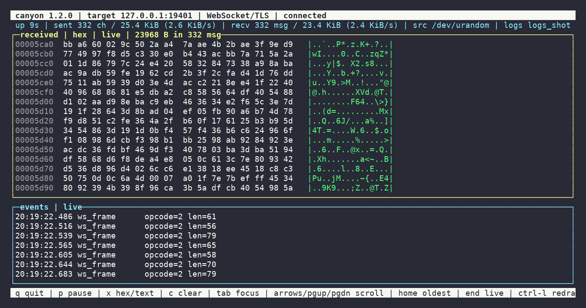

# canyon

`canyon` is a lightweight TCP/UDP socket flooding and fuzzing tool written in C.
It plugs a random byte stream directly into a socket and logs everything that
comes back. It is designed for penetration testing and service hardening:
feeding a target with unpredictable data (`/dev/random` or any file) and
recording the responses, so you can spot crashes, leaks, protocol aborts or
unexpected behaviour.

It supports both **TCP** and **UDP**, can route TCP traffic through a
**SOCKS5 proxy** (with optional username/password authentication), wrap the
connection in **TLS** to audit HTTPS/WSS endpoints, speak the **WebSocket**
(RFC 6455) or plain **HTTP** protocol against a specific endpoint path, and
use a **domain hostname** instead of the raw IP (for SNI, certificate
verification and the HTTP `Host:` header). Every byte received on the socket
is persisted to disk.



*The interactive TUI (`-T`): a live hexdump of everything the target sends
back, plus counters, rates and an event log — one screen that never floods
your terminal.*

> **Disclaimer:** Use canyon only against systems you own or have explicit
> written authorization to test. You are responsible for what you do with it.

## Features

- TCP and UDP flooding from `/dev/urandom` (default), `/dev/random`, or any file
  (`-r /path/to/file`).
- Randomised chunk sizes and inter-chunk delays (`-c MIN-MAX`, `-d MIN-MAX`).
- SOCKS5 proxy support with RFC 1929 user/pass authentication (`-x`, `-U`, `-P`).
- Optional TLS/SSL transport (`-s`) for auditing HTTPS and WSS endpoints, with
  optional certificate verification (`--ssl-verify`, `--ssl-ca`).
- WebSocket protocol (RFC 6455) support (`-w`) with random binary or text
  frames, ping/pong replies and automatic reconnect.
- Plain HTTP mode (`--http`) that sends an initial `GET` to an endpoint path
  (`--path`) and then keeps flooding the connection.
- Domain hostname support (`--sni <host>`) used for SNI, certificate
  verification and the HTTP/WS `Host:` header instead of the raw IP.
- Automatic TCP reconnect on dropped connections (enabled by default).
- Full logging of received data:
  - **TCP**: raw byte stream written to `stream-<tag>.log` (auto-rollover with `-m`).
  - **UDP**: every datagram saved as its own `.bin` file under `datagrams-<tag>/`.
  - Both protocols write a machine-readable **JSONL** `events-<tag>.log`.
- Configurable runtime limit (`-t`) and chunk budget (`-n`).
- `--recv-only` / `--no-recv` modes to listen or to flood without listening.
- Interactive ncurses TUI (`-T`): live hexdump/text view of the received
  data, sent/recv counters with rates, connection state and an event log on
  a single screen. Scrollback is bounded and repaints are throttled, so a
  full-speed flood never spams the terminal; disk logging is unaffected.
- No external dependencies beyond POSIX, pthreads, libc and OpenSSL (libssl);
  ncurses is optional (the TUI is stubbed out when its headers are missing).

## Build

```sh
make            # builds ./canyon
make test       # runs the smoke tests (TCP, UDP, SOCKS5, TLS, WSS, HTTP)
sudo make install   # installs to /usr/local/bin
```

Requires a C11 compiler, `pthreads` (glibc/musl) and OpenSSL development
headers (`libssl-dev` / `openssl-devel`). `pkg-config` is used to find the
OpenSSL flags when available. For the interactive TUI (`-T`) the ncurses
development headers are used when present (`libncursesw-dev` /
`ncurses-devel`); without them canyon still builds, with the TUI stubbed out.

## Usage

```
canyon [options]
```

The only required option is the target port. A target host defaults to
`127.0.0.1`.

### Options

| Option | Description |
| --- | --- |
| `-H, --host <host>` | Target host (default `127.0.0.1`). |
| `-p, --port <port>` | Target port **(required)**. |
| `-u, --udp` | Use UDP instead of TCP. |
| `-x, --socks5 <host:port>` | Route TCP traffic through a SOCKS5 proxy. |
| `-U, --socks5-user <user>` | SOCKS5 username (RFC 1929 auth). |
| `-P, --socks5-pass <pass>` | SOCKS5 password. |
| `-s, --ssl` | Wrap the connection in TLS (HTTPS / WSS). |
| `--ssl-verify` | Verify the server certificate against the system trust store. |
| `--ssl-ca <file>` | CA bundle to trust (implies `--ssl-verify`). |
| `--sni <host>` | Hostname used for SNI, certificate verification and the HTTP/WS `Host:` header (instead of the target IP). |
| `--http` | Send an initial `GET` to `--path` first, then keep flooding the connection. |
| `-w, --websocket` | Speak the WebSocket protocol (RFC 6455) instead of raw bytes. |
| `--path <path>` | Request path / endpoint (default `/`). |
| `--ws-path <path>` | Alias for `--path`. |
| `--ws-text` | Send WebSocket text frames instead of binary. |
| `-r, --random-source <file>` | File to read random bytes from (default `/dev/urandom`; `/dev/random` works too). |
| `-c, --chunk <MIN[-MAX]>` | Bytes per chunk sent (default `4096`; a range picks a random size per chunk). |
| `-d, --delay <MIN[-MAX]>` | Delay between chunks in microseconds. |
| `-t, --timeout <secs>` | Stop after N seconds (`0` = unlimited). |
| `-n, --count <N>` | Send at most N chunks (`0` = unlimited). |
| `-R, --reconnect` | Reconnect when a TCP connection drops (enabled by default; flag kept for compatibility). |
| `-D, --reconnect-delay <us>` | Delay before reconnecting (default `1000000` µs). |
| `-o, --outdir <dir>` | Output directory (default `canyon-logs`). |
| `-m, --max-log <bytes>` | Max size per received-data log file (TCP stream rollover). |
| `-N, --no-recv` | Do not read anything from the socket. |
| `-E, --recv-only` | Only read from the socket, do not send. |
| `-T, --tui` | Interactive ncurses interface: live hexdump of the received data, stats and event log. Falls back to log mode when not attached to a terminal. |
| `-v, --verbose` | Verbose output. |
| `-q, --quiet` | Suppress informational output. |
| `-V, --version` | Print version and exit. |
| `-h, --help` | Show help and exit. |

## Examples

```sh
# Flood a local HTTP port over TCP with 4 KiB random chunks
canyon -p 8080

# Flood 8.8.8.8:53 with 512-byte UDP datagrams
canyon -u -p 53 -H 8.8.8.8 -c 512

# Send random chunks between 1 KiB and 8 KiB, 100-1000 µs apart
canyon -p 3306 -c 1024-8192 -d 100-1000

# Route the traffic through a local SOCKS5 proxy
canyon -p 8080 -x 127.0.0.1:1080

# ...with username/password authentication
canyon -p 8080 -x proxy.example.com:1080 -U bob -P s3cret

# Stay connected, reconnecting whenever the connection drops
canyon -p 22 -D 500000

# Audit an HTTPS endpoint (TLS without certificate verification, by default)
canyon -p 443 -H 1.2.3.4 -s --http --path /api --sni example.com

# ...with strict verification against a CA bundle
canyon -p 443 -H example.com -s --ssl-verify --http --path /admin

# Fuzz a WSS WebSocket endpoint using the domain hostname
canyon -p 443 -H example.com -s -w --path /ws

# Listen only for 10 seconds (no data is sent)
canyon -p 12345 -E -t 10

# Use /dev/random as the byte source and stop after 1000 chunks
canyon -p 8080 -r /dev/random -n 1000 -o /var/log/canyon

# Watch the session live in the ncurses TUI (received data, stats, events)
canyon -T -p 8080
canyon -T -p 443 -H example.com -s -w --path /ws
```

## Interactive TUI (`-T`)

With `-T` canyon takes over the terminal with an ncurses interface instead of
printing logs to it. Everything the target sends back is visible as it
arrives, without flooding the screen:

- **title bar** — version, target, protocol/mode and connection state;
- **stats bar** — uptime, chunks/bytes sent and messages/bytes received with
  live rates;
- **data pane** — scrolling hexdump (or wrapped text) of the received bytes;
  the last 1 MiB stays available as scrollback;
- **events pane** — connects/disconnects, TLS/WebSocket/HTTP metadata, errors
  and verbose logs (last 1024 lines);
- **help bar** — the available keys.

The screen repaints at a fixed rate no matter how fast data arrives, and disk
logging (`stream-*.log`, `datagrams-*/`, `events-*.log`) continues exactly as
in log mode. `q` quits cleanly (same as Ctrl-C).

| Key | Action |
| --- | --- |
| `q` | Quit (equivalent to Ctrl-C). |
| `p` | Pause / resume sending (the status bar shows `PAUSED`). |
| `x` | Toggle hexdump / text view of the received data. |
| `c` | Clear the on-screen scrollback (counters and disk logs are kept). |
| `Tab` | Move the scroll focus between the data and events panes. |
| `↑` `↓` `PgUp` `PgDn` | Scroll the focused pane away from / towards the live tail. |
| `Home` / `End` | Jump to the oldest buffered line / back to live. |
| mouse wheel / click | Scroll / focus the pane under the cursor. |
| `Ctrl-L` | Force a full repaint. |

If stdin or stdout is not a terminal (pipes, CI, `nohup`), canyon prints a
warning and continues in the classic log mode; the same happens when the
terminal is too small (< 48x10) or when canyon was built without ncurses.

## Logging

All received data and events are stored under the output directory
(`canyon-logs` by default). Files are tagged with a timestamp and the canyon PID,
so concurrent runs never collide.

```
canyon-logs/
├── events-20260818-164117-53161.log     # JSONL event log (all runs)
├── stream-20260818-164117-53161.log     # TCP: raw received byte stream
└── datagrams-20260818-164117-53161/     # UDP: one .bin file per datagram
    └── d_0.bin
```

- **TCP** received bytes are appended raw to `stream-<tag>.log`. Use `-m` to cap
  the size of each file; when the limit is reached canyon rolls over to
  `stream-<tag>-1.log`, `stream-<tag>-2.log`, ...
- **UDP** received datagrams are stored individually as `d_<seq>.bin` files.
- The **events** log is newline-delimited JSON and records start/connect/
  disconnect/end plus send, datagram, TLS, WebSocket and HTTP metadata:

```json
{"ts":1787071528361,"type":"start","msg":"canyon 1.0.0 target=127.0.0.1:19191 proto=tcp via socks5"}
{"ts":1787071528365,"type":"connect","msg":"connected to 127.0.0.1:19191 (via socks5)"}
{"ts":1787071528366,"type":"ws_frame","msg":"opcode=2 len=64"}
{"ts":1787071528966,"type":"disconnect","msg":"connection closed"}
{"ts":1787071528966,"type":"end","msg":"shutting down (sent=3 rc=0)"}
```

Events include `tls_error`, `ws_error`, `http_request`, `ws_frame`, `ws_close`,
`ws_ping`, `ws_pong`, `connect_error`, `random_error`, and more.

## SOCKS5 support

`canyon` implements the SOCKS5 CONNECT command (RFC 1928) and the username/
password authentication sub-negotiation (RFC 1929). Both IP addresses and
hostnames are supported as destinations, over IPv4 or IPv6.

**Note:** SOCKS5 is only supported for TCP. SOCKS5 UDP ASSOCIATE is not
implemented; passing `-x` together with `-u` is rejected with an error.

## TLS (HTTPS / WSS)

Pass `-s, --ssl` to wrap the TCP connection in TLS before any HTTP/WebSocket
exchange. Use `--sni <host>` to identify the target by its domain name: it is
sent as the SNI extension, used for certificate hostname verification, and used
in the HTTP/WebSocket `Host:` header (instead of the raw IP).

By default TLS connections are **not** certificate-verified (pentest-friendly).
Enable verification with `--ssl-verify` (against the system trust store) or
`--ssl-ca <file>` (against a specific CA bundle, which implies `--ssl-verify`).
When verification is enabled and the handshake fails, the connection is not
used and a `tls_error` event is logged.

## WebSocket

`-w, --websocket` makes canyon speak RFC 6455 on top of TCP (optionally over
TLS, i.e. WSS):

- sends masked random **binary** frames (`--ws-text` switches to text frames);
- parses and logs incoming frames (text/binary payloads go to the stream log);
- replies to `ping` frames with `pong`;
- handles fragmented and oversized frames (oversized frames are skipped);
- reconnects automatically if the connection drops.

## HTTP

`--http` sends an initial `GET` to the endpoint path before flooding the
connection, so requests to `--path` can be fuzzed on a live web service. The
path must start with `/` (default `/`). `--http` and `--websocket` are mutually
exclusive; both require TCP.

## Random source

By default canyon reads from `/dev/urandom`, which never blocks and is the
recommended source. On Linux kernels >= 5.6 `/dev/random` behaves the same way;
on older kernels it may block when the entropy pool is low. You can point
`-r` at any readable file (for example a replay corpus or a fixed pattern) and
canyon will read from it until EOF.

## Tests

```sh
make test
```

`tests/smoke.sh` spins up throwaway Python services (including TLS and WSS
echo servers with a locally generated certificate) and verifies that canyon:

1. floods a TCP echo server and logs the responses;
2. tunnels the same traffic through a SOCKS5 proxy;
3. floods a UDP echo server and stores every datagram;
4. rejects UDP-over-SOCKS5 with a clear error;
5. speaks WebSocket against an RFC 6455 echo server;
6. runs continuously until a signal arrives;
7. reconnects after the server drops the connection;
8. wraps traffic in TLS (HTTPS), with and without certificate verification,
   and rejects untrusted certificates;
9. speaks WSS against a TLS-wrapped WebSocket echo server;
10. sends an HTTP `GET` to a path endpoint using the `--sni` hostname in the
    `Host:` header;
11. falls back to classic log mode when `-T` is used without a terminal;
12. runs `-T` inside a pty, shows the received data on screen, honours the
    `x`/`p` keys and quits cleanly on `q`.

## Project layout

```
src/canyon.c     main entry point, CLI parsing, session orchestration
src/net.c        socket helpers (connect with timeout, UDP connect, send-all)
src/socks5.c     SOCKS5 handshake (RFC 1928 / RFC 1929)
src/rand.c       random byte source + PRNG for sizes/delays
src/logbook.c    received-data and event logging
src/tls.c        TLS/SSL transport abstraction (OpenSSL, conn_t)
src/ws.c         WebSocket frames and handshake (RFC 6455)
src/tui.c        interactive ncurses interface (-T)
tests/smoke.sh   end-to-end smoke tests
docs/tui.png     screenshot of the interactive TUI
```

## License

MIT. See [LICENSE](LICENSE).

Homepage: <https://github.com/manalejandro/canyon>
